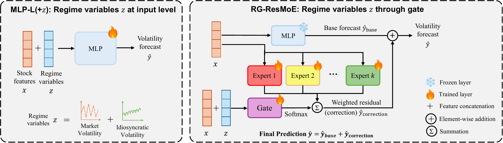

# RG-ResMoE

**Regime-Gated Residual Mixture-of-Experts for Cross-Sectional Volatility Forecasting**
Junyi Ye, Gargi Vijay Borde · accepted to ICAIF '26 · [paper PDF](paper/RG-ResMoE_ICAIF26.pdf)

This repo contains the code and data behind the paper. It forecasts
five-day stock volatility for over 1,000 U.S. equities, and shows that a
mixture-of-experts model does best when market-regime information is used
only to *route* between experts — never fed into the forecast itself.

## Why this paper

Financial markets move through regimes — calm periods, crises, recoveries.
A growing line of work uses mixture-of-experts (MoE) architectures to
handle this: the idea is that different experts can specialize in different
market conditions. These models often beat plain baselines. But it's rarely
clear *why*.

A typical MoE setup changes three things at once relative to its baseline.
It exposes the model to regime information it didn't have before. It adds
parameters — usually a lot of them, since an MoE baseline is commonly
compared against a much smaller plain MLP, not one with a matching
parameter count. And it introduces a new mechanism — routing between
specialized sub-models. Any of the three could be driving the improvement,
but most papers compare against an MLP with far fewer parameters, so
capacity and architecture are never actually separated.

This paper isolates that question. Every model we compare has a matched
parameter budget, the same regime information available to it, and the
same tuning/evaluation protocol. The only thing we vary is *how* — and
*whether* — regime information reaches the model. That lets us ask
cleanly: does the gain come from having the information, from having more
capacity, or from the gating/expert architecture itself?

The answer is the architecture, not capacity. Against a plain MLP with the
*same* parameter count as RG-ResMoE, giving that MLP the same regime
variables at its input still hurts it — while routing those same variables
through an MoE gate helps. Same information, same capacity, opposite
outcome. The benefit comes from *where* the information enters the model,
not from how much of it there is, and not from having more parameters.

## How it works



RG-ResMoE has two parts:

1. A **frozen base network** predicts volatility from a stock's own price
   history.
2. A small team of **correction experts** learns to adjust that forecast.
   A **gate** decides how much weight each expert gets — and it's the
   only part of the model allowed to see market-regime signals (overall
   market volatility, and a stock's own idiosyncratic volatility).

Keeping regime information out of the forecast and only in the gate turns
out to matter a lot: it beats an equally-sized MLP on accuracy, risk
calibration, and training stability, and the same result holds on an
independent Japanese stock panel.

## Quick start

```bash
pip install -r requirements.txt
bash reproduce.sh          # builds the data panel, trains every model, aggregates results
```

That reproduces the paper's main U.S. results end to end. It needs a CUDA
GPU for training (one model/seed per GPU) and takes a while — each step
skips work that's already done, so it's safe to stop and resume.

Want more than the headline table?

```bash
RUN_ABLATIONS=1 bash reproduce.sh   # + routing/design ablations (Tables 5-6)
bash reproduce_jp.sh                # + the Japan replication (Table 9)
```

## What's inside

```text
src/                   Pipeline code: build the data panel, train each model, score results
data/raw/              Daily U.S. stock prices (1,029 tickers) — exactly what the paper used
data/raw_jp/           Daily Japanese stock prices (1,555 tickers), for the replication study
results/reference/     The paper's own output, so you can check your run against it
```

Everything else (`data/processed/`, `results/predictions/`,
`results/summary/`) gets created as you run the pipeline.

## Reproducing a specific result

`src/train_rg_resmoe.py` is the main model. A handful of environment
variables switch it into the other configurations reported in the paper —
expert count, routing style, whether the gate sees regime info. The
baselines and routing variants it's compared against live in
`src/train_mlp.py`, `src/train_standard_moe.py`, and `src/train_rule_gate_moe.py`.

If you're trying to match a specific table or number in the paper, open
`reproduce.sh` instead — it lists every model/flag combination as a single
runnable command, in the order the tables need them.

## Notes

- The shipped CSVs are the exact data used in the paper. Yahoo Finance
  revises its history over time, so a fresh download won't match bit-for-bit.
- Every neural model is trained with 30 random seeds; significance tests
  average results across seeds first, then compare day by day (Diebold-Mariano,
  Newey-West lag 4).
- The Japan replication reuses the hyperparameters selected on the U.S.
  data — the paper found the same configuration worked best on both.

## Citation

```bibtex
@inproceedings{ye2026rgresmoe,
  title     = {Regime-Gated Residual Mixture-of-Experts for Cross-Sectional Volatility Forecasting},
  author    = {Ye, Junyi and Borde, Gargi Vijay},
  booktitle = {Proceedings of the 7th ACM International Conference on AI in Finance (ICAIF '26)},
  year      = {2026}
}
```

## License

MIT (see LICENSE). Raw price data derive from Yahoo Finance and are provided
for research reproducibility only.
