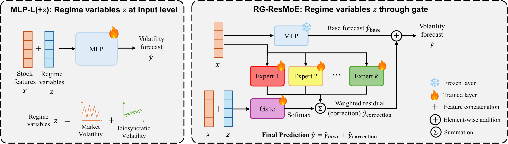

# RG-ResMoE

**Regime-Gated Residual Mixture-of-Experts for Cross-Sectional Volatility Forecasting**
Junyi Ye, Gargi Vijay Borde · ICAIF '26 · [paper PDF](paper/RG-ResMoE_ICAIF26.pdf) · [doi:10.1145/3858063.3858798](https://doi.org/10.1145/3858063.3858798) · [poster](presentation/ICAIF26_Poster_RG-ResMoE.pdf) · [slides](presentation/ICAIF26_Slides_RG-ResMoE.pdf)

This repo contains the code and data behind the paper. It forecasts
five-day stock volatility for over 1,000 U.S. equities, and shows that a
mixture-of-experts model does best when market-regime information is used
only to *route* between experts, never fed into the forecast itself.

## Why this paper

Financial markets move through regimes: calm periods, crises, recoveries. A growing line of work uses mixture-of-experts (MoE) architectures to handle this, on the idea that different experts can specialize in different market conditions. These models often beat plain baselines. But it is rarely clear why.

Relative to its baseline, a typical MoE changes three things at once:

- **Information:** the gate sees regime variables the baseline never had.
- **Capacity:** the MoE has more parameters, and is often compared against a smaller single network.
- **Architecture:** it routes between specialized sub-models.

Any of the three could be driving the improvement. When they change together, the gain cannot be attributed, and the explanation offered for it may simply be wrong.

This paper separates them. The regime variables are fixed, the key baseline is an MLP with the same parameter count as RG-ResMoE, and every model shares the same features, walk-forward protocol, tuning rules and 30 random seeds. We then vary one factor at a time: where regime information enters (input, gate, or not at all), how experts are routed (soft or hard), and whether experts predict full forecasts or residual corrections to a frozen base forecast.

**The answer is the architecture, not capacity or information.**

- **Information alone does not help.** Giving the capacity-matched MLP the regime variables at its input lowers IC (−0.0043) and makes all 30 seeds collapse.
- **Capacity alone does not explain it.** The capacity-matched MLP is worse than RG-ResMoE on every forecast metric.
- **The residual architecture does.** A frozen base forecaster with zero-initialized correction experts beats the capacity-matched MLP by +0.0048 IC and never collapses. Without the frozen base (a standard MoE), 24 of 30 seeds collapse; with random instead of zero initialization, 13 of 30.
- **Where the information enters still matters, but for safety.** Appended to the input, the regime variables hurt; routed through the gate, they do not.

Same information, same capacity: whether regime variables help or hurt depends on where they enter, and the gain itself comes from the residual design.

## How it works



RG-ResMoE has two parts:

1. A **frozen base network** predicts volatility from a stock's own price
   history.
2. A small team of **correction experts** learns to adjust that forecast.
   A **gate** decides how much weight each expert gets, and it's the only
   part of the model allowed to see market-regime signals (overall market
   volatility, and a stock's own idiosyncratic volatility).

Keeping regime information out of the forecast and only in the gate turns
out to matter a lot: it beats an equally-sized MLP on accuracy, risk
calibration, and training stability, and the same result holds on an
independent Japanese stock panel.

## Quick start

```bash
pip install -r requirements.txt
bash reproduce.sh          # builds the data panel, trains every model, aggregates results
```

That reproduces the paper's main U.S. results end to end: Table 3 (headline
forecasting results), Table 4 (the regime-information pathway comparison),
Table 7 (VaR coverage) and Table 8 (stress slices). It needs a CUDA GPU for
training (one model/seed per GPU); each step skips work that's already done,
so it's safe to stop and resume.

Want more than the headline table?

```bash
RUN_ABLATIONS=1 bash reproduce.sh   # + routing/design ablations (Tables 5-6)
bash reproduce_jp.sh                # + the Japan replication (Table 9)
```

Budget roughly, at 30 seeds: the default U.S. run is ~12 GB of per-seed
prediction files and a few hours of GPU time (plus ~10 min of CPU for the
per-stock GARCH fits); adding `RUN_ABLATIONS=1` takes it to ~32 GB, and the
Japan replication adds ~11 GB. The feature panels themselves are ~1.5 GB.
Everything lands under `data/processed/` and `results/`, both gitignored.

## What's inside

```text
src/                   Pipeline code: build the data panel, train each model, score results
data/raw/              Daily U.S. stock prices (1,029 tickers), exactly what the paper used
data/raw_jp/           Daily Japanese stock prices (1,552 tickers), for the replication study
results/reference/     The paper's own output, so you can check your run against it
```

Everything else (`data/processed/`, `results/predictions/`,
`results/summary/`) gets created as you run the pipeline.

## Reproducing a specific result

`src/train_rg_resmoe.py` is the main model. A handful of environment
variables switch it into the other configurations reported in the paper:
expert count, routing style, whether the gate sees regime info. The
baselines and routing variants it's compared against live in
`src/train_mlp.py`, `src/train_standard_moe.py`, `src/train_rule_gate_moe.py`,
`src/train_ridge.py`, and `src/train_classical_baselines.py` (Persistence,
HAR, GARCH).

If you're trying to match a specific table or number in the paper, open
`reproduce.sh` instead. It lists every model/flag combination as a single
runnable command, in the order the tables need them.

## Notes

- The shipped CSVs are the exact data used in the paper. Yahoo Finance
  revises its history over time, so a fresh download won't match bit-for-bit.
- Every neural model is trained with 30 random seeds; significance tests
  average results across seeds first, then compare day by day (Diebold-Mariano,
  Newey-West lag 4).
- The Japan replication reuses the hyperparameters selected on the U.S.
  data: the paper found the same configuration worked best on both.
- `results/reference/` holds the paper's 30-seed numbers, with row labels
  kept in step with the current scripts so a fresh run lines up directly.
  One row is absent: `collapse_rate_by_model.csv` has no `RG-ResMoE-K6`,
  because that variant was added after this reference was generated.

## Citation

If you find this repo useful, please consider giving it a star ⭐ and citing the paper:

```bibtex
@inproceedings{ye2026rgresmoe,
  title     = {Regime-Gated Residual Mixture-of-Experts for Cross-Sectional Volatility Forecasting},
  author    = {Ye, Junyi and Borde, Gargi Vijay},
  booktitle = {Proceedings of the 7th ACM International Conference on AI in Finance (ICAIF '26)},
  year      = {2026},
  pages     = {1687--1694},
  address   = {Milan, Italy},
  publisher = {ACM},
  doi       = {10.1145/3858063.3858798},
  url       = {https://doi.org/10.1145/3858063.3858798}
}
```

## License

MIT (see LICENSE). Raw price data derive from Yahoo Finance and are provided
for research reproducibility only. The paper PDF is CC BY 4.0.
